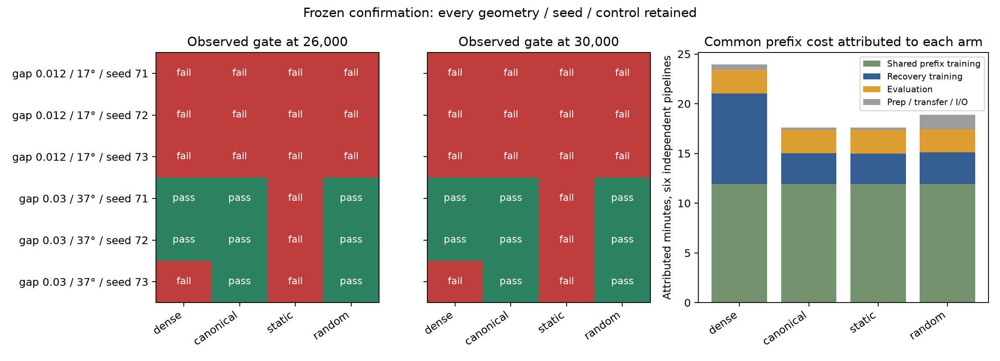

# Balanced sampling under a bounded, frozen confirmation campaign

## Abstract

The frozen consistency criterion was not met: on two preregistered rotated parallel-plate geometries (gaps 0.012/0.03; angles 17/37 degrees) and seeds 71–73, balanced 16,384-point cycling achieved observed persistent structural recovery at 26k/30k and both grids 192/384 in 3/6 paired trajectories versus dense 2/6, using 75% fewer recovery gradient point presentations, 66.1% less measured recovery training time and 26.5% less attributed prefix-plus-recovery-plus-evaluation runtime. Random sampling recovered 3/6, so balancing superiority is unsupported. It failed all three seeds on gap 0.012 / angle 17°, where dense also failed on resolved references; consistent preservation across this subset is unsupported.

Exactly three scientific batches were attempted, charging **71.15 minutes** of the 120-minute training/evaluation allowance including every model-test subprocess, preparation, I/O, failed work and the linked recovery segment. Twenty targeted tests passed; both earlier fixture failures are retained. All 96 newly evaluated recovery checkpoints plus 12 new shared-prefix checkpoints are retained; historical input checkpoints are separate. Six complete reserved cases remain untouched.

## Hypothesis and preregistration

The hypothesis was that balanced 16,384-point cycling preserves dense observed geometric recovery with substantially less compute across new geometries and paired seeds. Batch 1 first tested canonical, phase-shifted and independently shuffled presentation order on the six development pairs. All three orders passed every frozen structural/error/compute criterion. Both subsequent confirmation batches, executable code, designated cases and all thresholds were frozen together in [confirmation-manifest.json](confirmation-manifest.json) before any reserved points, probes or models were generated. Both batches ran without tuning, including failed cases.

The designated subset is exactly the first two archived cases: gap 0.012/17-degree and gap 0.03/37-degree parallel plates, each with seeds 71,72,73 and global_narrow. The other parallel-plate case, all three mixed-thickness cases and both multiscale-stack cases remain untouched. This is confirmation in one analytic geometry family, not evidence across families.

## Methods

Each geometry/seed trained one shared width 128, depth 3 SIREN prefix: 10,000 stochastic ordinary-MSE updates at 1e-4 with 2048 points, followed by 10,000 identical cosine-decay updates. Model, Adam and sampling RNG were saved and forked into all four recovery arms. Each arm then used 10,000 ordinary equal-point MSE updates with the frozen cosine schedule 1e-4 to 1e-6. Chunk squared-error sums are divided by total targets, with one Adam update.

Dense uses 65,536 points each update. Canonical cycles balanced 16,384-point blocks 0,1,2,3 from the same pool. Static repeatedly uses its balanced first 16,384 points. Random samples 16,384 genuinely unstratified indices without replacement at each update using a dedicated independent CPU RNG and precomputed saved schedules. All arms share pool coordinates/labels and independent evaluation data. The pool remains 50% original sampler, 25% full gap and 25% facing interior. Gap/interior sampling and footprint splits use the local geometry frame, rotated into world coordinates; full-gap bins cover the entire gap width. Analytic SDF labels and oracle gap/interior regions from the known geometry are required; this study does not estimate those regions for arbitrary inputs.

Persistent structural recovery requires all original gap/interior probe signs plus two closed mesh components and Euler 4 at BOTH 192 and 384 at BOTH 26k and 30k, with resolved analytic reference meshes. Missing meshes, nonfinite results, unresolved references and missing observations cannot pass. The canonical criterion requires all six pairs, no dense-pass/candidate-fail pair, mean Chamfer at each grid<=1.05 × dense, independent gap RMSE<=1.10 × dense, sampled gap sign delta>=-0.005 at each checkpoint, and aggregate recovery training<=90% dense.

## Order gate and validity

All 48 development checkpoints passed the structural gate. Canonical, phase 1 and per-cycle shuffle each retained 6/6 persistent pairs and passed all guardrails. All 24 dense/canonical historical model, Adam and sampling-RNG checkpoints reproduced exactly. Their measured training/dense ratios were 0.33884,0.33841,0.33883. The largest gap RMSE ratio was 1.05440, largest Chamfer ratio 1.00268 and worst sampled gap sign delta was -0.001372. The [frozen order-gate manifest](batch-1-manifest.json) and [gate audit](audit.json) retain exact source/input hashes and all reproduction results.

OneDrive denied a completion-marker replacement after local 33 shuffle 30k full measurements had been saved. The failed 1588.4591-second attempt, traceback and both markers are retained. An I/O-only recovery verified all eight temp-marker payload hashes, recovered the measurements without any repeated training/evaluation, and ran only the two missing dense 33 stages. Its 128.7097 seconds were also charged to logical batch 1. The unpersisted shuffle 30k enclosing stage timer remains null; training/evaluation timers are intact and counted once. Dense 33 ran after a pause, weakening the intended execution-order timing comparison. Frozen science remained unchanged. The embedded new gate protocol governs; inherited legacy protocol-hash/selection fields remain unchanged and are explicitly annotated.

## Confirmation results



| Arm | Persistent pairs | Recovery presentations (six pairs) | Recovery train seconds | Evaluation seconds | Random schedule prep seconds | Attributed full pipeline seconds |
|---|---:|---:|---:|---:|---:|---:|
| dense | 2/6 | 3,932,160,000 | 546.70 | 141.72 | 0.00 | 1437.26 |
| canonical | 3/6 | 983,040,000 | 185.39 | 142.70 | 0.00 | 1055.88 |
| static | 0/6 | 983,040,000 | 184.36 | 143.71 | 0.00 | 1055.85 |
| random | 3/6 | 983,040,000 | 190.56 | 140.82 | 68.06 | 1131.99 |

| Gap / angle | Seed | Arm | Gate 26k | Gate 30k | Persistent | Reference resolved |
|---|---:|---|---|---|---|---|
| 0.012 / 17 | 71 | dense | False | False | False | True |
| 0.012 / 17 | 71 | canonical | False | False | False | True |
| 0.012 / 17 | 71 | static | False | False | False | True |
| 0.012 / 17 | 71 | random | False | False | False | True |
| 0.012 / 17 | 72 | dense | False | False | False | True |
| 0.012 / 17 | 72 | canonical | False | False | False | True |
| 0.012 / 17 | 72 | static | False | False | False | True |
| 0.012 / 17 | 72 | random | False | False | False | True |
| 0.012 / 17 | 73 | dense | False | False | False | True |
| 0.012 / 17 | 73 | canonical | False | False | False | True |
| 0.012 / 17 | 73 | static | False | False | False | True |
| 0.012 / 17 | 73 | random | False | False | False | True |
| 0.03 / 37 | 71 | dense | True | True | True | True |
| 0.03 / 37 | 71 | canonical | True | True | True | True |
| 0.03 / 37 | 71 | static | False | False | False | True |
| 0.03 / 37 | 71 | random | True | True | True | True |
| 0.03 / 37 | 72 | dense | True | True | True | True |
| 0.03 / 37 | 72 | canonical | True | True | True | True |
| 0.03 / 37 | 72 | static | False | False | False | True |
| 0.03 / 37 | 72 | random | True | True | True | True |
| 0.03 / 37 | 73 | dense | False | False | False | True |
| 0.03 / 37 | 73 | canonical | True | True | True | True |
| 0.03 / 37 | 73 | static | False | False | False | True |
| 0.03 / 37 | 73 | random | True | True | True | True |

Every seed and failure is retained in [confirmation-checkpoints.csv](confirmation-checkpoints.csv), including ordinary training-pool and independent MSE, gap RMSE, signs, meshes and strict fit failures. Overall MSE is the 50/25/25 weighted mean of the stored original/gap/interior subset MSE values, exactly matching their pool proportions. [confirmation-paired-differences.csv](confirmation-paired-differences.csv) gives cycling-minus-dense/random/static differences for each paired seed and checkpoint, including structural regressions. [confirmation-distance-bins.csv](confirmation-distance-bins.csv) reports independent versus training errors by distance and footprint. Exact frozen threshold comparisons are in [confirmation-decision.json](confirmation-decision.json).

## Compute accounting

Recovery gradient presentations are 163,840,000 for each sampling arm versus 655,360,000 for dense: 75% fewer. The shared prefix presents 40,960,000 training points, yielding 204,800,000 versus 696,320,000 total prefix-plus-recovery gradient presentations: 70.59% fewer. These counts exclude diagnostic/evaluation queries; all such work remains in measured runtime. No dense label/storage saving is claimed. Prefix computation is executed once per pair and its SAME measured cost is attributed to each arm when comparing independent full pipelines. Summing attributed arm totals therefore intentionally repeats the common cost; the campaign budget counts actual work once.

Attributed pipeline time includes shared-prefix stage work, pool preparation, arm-specific schedule preparation, recovery training/evaluation and recovery-stage I/O/transfer/hash work. Random schedule preparation is explicitly counted. Training and evaluation timers are measured separately with GPU synchronization. Whole-process charges also include other setup and audit overhead; per-arm attributed stage costs exclude small boundary-marker, summary and process-bookkeeping work, rather than reconstructing an unmeasured end-to-end arm wall clock. Measurements are descriptive serial timings on the same RTX 2080 Super, not universal speed guarantees.

## Failure analysis, controls and limitations

- canonical: persistent 3/6; training/dense ratio 0.3391; qualifies=False; dense-persistent losses=[].
- static: persistent 0/6; training/dense ratio 0.3372; qualifies=False; dense-persistent losses=[{'case_index': 1, 'seed': 71}, {'case_index': 1, 'seed': 72}].
- random: persistent 3/6; training/dense ratio 0.3486; qualifies=False; dense-persistent losses=[].

| Arm | Step | Gap RMSE / dense | Chamfer 192 / dense | Chamfer 384 / dense | Gap sign delta | Error guardrails pass |
|---|---:|---:|---:|---:|---:|---|
| canonical | 26,000 | 1.072651 | 0.999397 | 1.001577 | -0.001781 | True |
| canonical | 30,000 | 1.054104 | 0.998998 | 1.002165 | -0.000094 | True |
| static | 26,000 | 1.086355 | 1.122818 | 1.124542 | -0.007896 | False |
| static | 30,000 | 1.051710 | 1.141875 | 1.149952 | -0.002429 | False |
| random | 26,000 | 1.065282 | 1.001783 | 1.000598 | -0.007913 | False |
| random | 30,000 | 1.024585 | 0.998037 | 1.000123 | -0.000829 | True |

Unresolved analytic references are measurement limitations and are distinguished from prediction failures on resolved grids. No resolution or threshold was changed after exposure. Random/static control outcomes bound attribution: matching random performance does not establish that balancing is necessary or superior. Failures shared by dense and cycling cannot be attributed specifically to sampling. Gap width, angle and seeds all changed from development, so their individual causal effects are not isolated. These finite-training results do not establish representational impossibility. Sampled signs and finite-grid meshes cannot certify continuous topology or behavior between checkpoints. Three paired seeds per geometry are descriptive evidence, not an inferred population success rate. Six held-out cases and other geometry families remain untested.

Dense failures on the wider case include extra disconnected mesh components. The narrow case instead exhibits merged components and incorrect Euler characteristics; small distance or sign errors can coexist with either structural failure. Random matches cycling at 3/6 persistent structural successes but fails the 26k full-gap sign guardrail; static reaches 0/6 and fails distance guardrails. These paired outcomes do not establish balancing necessity or statistical superiority.

canonical failure gap 0.012, angle 17, seed 71, step 26000: original probe signs all correct=True; independent gap MSE=2.0983978e-06; r 192: components=1, Euler=-48, closed=True, reference_resolved=True, Chamfer=0.007728468407889454; r 384: components=1, Euler=-14, closed=True, reference_resolved=True, Chamfer=0.007738264569283797.
canonical failure gap 0.012, angle 17, seed 71, step 30000: original probe signs all correct=True; independent gap MSE=1.7702323e-06; r 192: components=1, Euler=-32, closed=True, reference_resolved=True, Chamfer=0.007679624633504744; r 384: components=1, Euler=-4, closed=True, reference_resolved=True, Chamfer=0.0076991487757090095.
canonical failure gap 0.012, angle 17, seed 72, step 26000: original probe signs all correct=True; independent gap MSE=2.1181347e-06; r 192: components=2, Euler=-54, closed=True, reference_resolved=True, Chamfer=0.007685786381305333; r 384: components=1, Euler=-16, closed=True, reference_resolved=True, Chamfer=0.0077254224670810535.
canonical failure gap 0.012, angle 17, seed 72, step 30000: original probe signs all correct=True; independent gap MSE=1.8586998e-06; r 192: components=1, Euler=-40, closed=True, reference_resolved=True, Chamfer=0.00770837558385974; r 384: components=1, Euler=-6, closed=True, reference_resolved=True, Chamfer=0.007732448126406942.
canonical failure gap 0.012, angle 17, seed 73, step 26000: original probe signs all correct=True; independent gap MSE=2.0822586e-06; r 192: components=1, Euler=-30, closed=True, reference_resolved=True, Chamfer=0.007716046878900103; r 384: components=1, Euler=-12, closed=True, reference_resolved=True, Chamfer=0.007737386078996391.
canonical failure gap 0.012, angle 17, seed 73, step 30000: original probe signs all correct=True; independent gap MSE=1.6107542e-06; r 192: components=2, Euler=-14, closed=True, reference_resolved=True, Chamfer=0.007687235413295869; r 384: components=2, Euler=0, closed=True, reference_resolved=True, Chamfer=0.0077215569667145436.
dense failure gap 0.03, angle 37, seed 73, step 26000: original probe signs all correct=True; independent gap MSE=1.6288705e-06; r 192: components=3, Euler=6, closed=True, reference_resolved=True, Chamfer=0.007829877606427369; r 384: components=3, Euler=6, closed=True, reference_resolved=True, Chamfer=0.0078097143455423505.
dense failure gap 0.03, angle 37, seed 73, step 30000: original probe signs all correct=True; independent gap MSE=1.2443969e-06; r 192: components=6, Euler=12, closed=True, reference_resolved=True, Chamfer=0.007755645561439884; r 384: components=5, Euler=10, closed=True, reference_resolved=True, Chamfer=0.007756648207884186.

## Reproducibility and retained evidence

The original checkout was read-only. The local input bundle contains all exact development parents, pools and historical reproduction checkpoints. Confirmation pools, independent data, shared prefix model/Adam/RNG, random schedules, every recovery checkpoint and both-grid metrics remain under runs/gap-confirmation/batch-2 and batch-3. Frozen source snapshots accompany each batch. [run-artifacts.json](run-artifacts.json) indexes every campaign input, source, model, schedule, metric, log and export by SHA-256 and size. [reservation-consumption.json](reservation-consumption.json) logs every selected-case generation/evaluation and lists the six untouched cases.

Set $python to the recorded Python environment or install requirements-windows-cu126.txt. The preparation command creates a new child workspace containing exact frozen source, all development inputs, reservation and manifests, with an empty independent budget and no runs. The gate wrapper adds only completion-marker I/O retries. The delivered numerical source hashes remain unchanged. The package and full retained-metrics reporter were verified in a clean workspace; no additional training replay was performed. These commands describe a separately authorized future reproduction, not extra campaign batches.

```powershell
$env:CUBLAS_WORKSPACE_CONFIG=':4096:8'
$env:PYTHONDONTWRITEBYTECODE='1'
& $python -m scripts.prepare_gap_reproduction --destination replay-new
Set-Location replay-new
& $python -m scripts.run_gap_replay
if ($LASTEXITCODE -ne 0) { throw 'Replay order gate failed; stop before confirmation.' }
& $python -m scripts.gap_reserved_confirmation budget-run --case-index 0
if ($LASTEXITCODE -ne 0) { throw 'First confirmation batch failed; stop.' }
& $python -m scripts.gap_reserved_confirmation budget-run --case-index 1
if ($LASTEXITCODE -ne 0) { throw 'Second confirmation batch failed; stop.' }
& $python -m scripts.report_reserved_confirmation
```

The original budget ledger rejects another scientific batch or exhausted budget. Reporting hashes and reads retained metrics without model evaluation. Its paper narrative describes this retained campaign, including its original I/O interruption; a fresh replay must report its own budget and infrastructure events rather than reuse those historical details.
