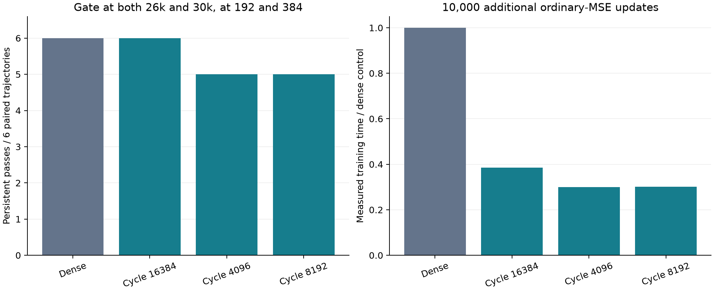

# Can sampling retain dense-data structural recovery with less compute?

The best qualifying tested method is **cycle-16384**. It retained observed persistent structure in **6/6** paired development trajectories, using **75.00% fewer point presentations** and **61.4% less measured training time** than the rerun dense control. This compares the additional 10,000-update recovery stage from shared 20,000-update checkpoints.

Completed **3 new batches**, **72 checkpoints** and **144 grid evaluations**. Conservative run wall time plus the verification suite was **38.38 minutes**, below the two-hour allowance. No additional batch will be run under this goal. Fresh cases remain reserved.



| Method | Batch | Persistent | Presentations per trajectory | Training seconds, six trajectories | Evaluation seconds | Final independent gap RMSE |
|---|---:|---:|---:|---:|---:|---:|
| dense | 1 | 6/6 | 655,360,000 | 664.94 | 227.59 | 0.00108283 |
| cycle-16384 | 1 | 6/6 | 163,840,000 | 256.55 | 236.94 | 0.0011342 |
| cycle-4096 | 2 | 5/6 | 40,960,000 | 198.79 | 198.06 | 0.00121037 |
| cycle-8192 | 3 | 5/6 | 81,920,000 | 200.70 | 197.10 | 0.00114083 |

## Protocol and controls

One existing development geometry: axis-aligned parallel plates with a 0.02 gap, width-128 depth-3 SIREN, original samplers global_narrow and local, paired seeds 31–33. Every trajectory restores its exact 20k model and Adam state. The objective is ordinary equal-point MSE, with the same endpoint-inclusive cosine schedule from 1e-4 to 1e-6 for 10k more updates. Adam is not restarted at evaluation checkpoints.

The saved 65,536-point pool is identical to the dense baseline. A cycling update presents one contiguous balanced block: 50% original-sampler points, 25% full-gap points and 25% facing-interior points. Blocks are disjoint and exhaustive over a cycle; no residuals or evaluation probes select training points. The original sampling RNG is preserved. Cycling changes both exposure order and gradient noise, so the experiment does not isolate them. All dense labels and storage remain necessary.

The unchanged structural gate requires all original probe signs, two mesh components, Euler characteristic four, closed edges and a resolved analytic reference at both 192 and 384. Persistent success requires passes at both 26k and 30k. Guardrails, frozen before batch 1 and kept throughout, require mean Chamfer at each grid within 5% of dense, independent gap RMSE within 10%, and full-gap sign accuracy no more than 0.5 percentage points worse, at both later checkpoints. Qualification also requires all six persistent passes, fewer presentations and at least 10% lower aggregate training time. These are descriptive tolerances, not statistical noninferiority tests.

The independent 65,536-point evaluation sets and 131,072 requested full-gap probes are unchanged. Exact-coordinate training/evaluation overlap is zero. Pool fit uses all dense points and retains the earlier strict subset-RMSE and strong-margin-sign criterion.

## Sequential decisions and retained negatives

### Batch 1

**Preregistered hypothesis:** Cycling balanced 16384-point subsets through the same 65536-point dense pool preserves observed persistent structure while reducing point presentations fourfold and measured training time.

[Preregistered controls and criteria](batch-1/manifest.json) · [All results](batch-1/report.md) · [Audit](batch-1/audit.json)

cycle-16384: 6/6 persistent; qualifies=True. Presentation ratio 0.2500; measured training-time ratio 0.3858. Both later-checkpoint guardrail measurements are retained in [decision.json](batch-1/decision.json).


### Batch 2

**Preregistered hypothesis:** Cycling 4096-point balanced blocks through the exact dense pool retains persistent structure at one sixteenth of dense point presentations. Coverage over successive updates, rather than repeatedly fitting a fixed sparse pool, may explain the improvement over the historical static 4096-point failure.

[Preregistered controls and criteria](batch-2/manifest.json) · [All results](batch-2/report.md) · [Audit](batch-2/audit.json)

cycle-4096: 5/6 persistent; qualifies=False. Presentation ratio 0.0625; measured training-time ratio 0.2990. Both later-checkpoint guardrail measurements are retained in [decision.json](batch-2/decision.json).

Guardrail failures: at 26000, gap RMSE ratio 1.1998, gap-sign change -0.472 percentage points, Chamfer ratios 1.0141/1.0166; at 30000, gap RMSE ratio 1.1178, gap-sign change +0.051 percentage points, Chamfer ratios 1.0019/1.0040.

The 4096-point negative result is retained in full. Local seed 33 has one mesh component at resolution 192 at 26k and recovers at 30k. All six final checkpoints pass, but only five trajectories satisfy persistence; independent gap RMSE also exceeds the frozen 10% tolerance at both later checkpoints. Early structural passes are 1/6 at 23k. No fourth batch or phase-shift run was substituted for this failure.

### Batch 3

**Preregistered hypothesis:** The intermediate 8192-point cycle reduces gradient noise enough to retain the dense baseline's persistent structure and error guardrails, while using one eighth of its point presentations.

[Preregistered controls and criteria](batch-3/manifest.json) · [All results](batch-3/report.md) · [Audit](batch-3/audit.json)

cycle-8192: 5/6 persistent; qualifies=False. Presentation ratio 0.1250; measured training-time ratio 0.3018. Both later-checkpoint guardrail measurements are retained in [decision.json](batch-3/decision.json).


| Method | Passing checkpoints | Passing-to-failing trajectories | Final pool-fit passes | Final full-gap signs | Final Chamfer 192 / 384 |
|---|---:|---:|---:|---:|---:|
| dense | 17/18 | 0 | 0/6 | 99.707% | 0.007776 / 0.007797 |
| cycle-16384 | 17/18 | 0 | 0/6 | 99.744% | 0.007776 / 0.007783 |
| cycle-4096 | 12/18 | 0 | 0/6 | 99.758% | 0.007790 / 0.007828 |
| cycle-8192 | 14/18 | 0 | 0/6 | 99.764% | 0.007783 / 0.007801 |

The earlier fixed-data controls remain negative context: fixed 4,096 points yielded 0/6 persistent passes and fixed 16,384 points yielded 2/6; dense full-data training yielded 6/6. Cycling retains dense coverage over time while reducing points per update. Those historical comparisons change the pool and presentation schedule together; they cannot identify coverage as the sole cause.

## Compute and evidence audit

Measured training: 22.02 minutes; measured evaluation: 14.33 minutes; total training presentations: 5,652,480,000. The conservative 38.38-minute charge additionally includes subprocess startup, data preparation, hashing, checkpoint I/O and the 10.23-second verification suite. All three batch processes completed normally; no interrupted or discarded research attempts are hidden. Pure report generation and hash audits perform no further model training or field/mesh evaluation.

For cycle-16384, combined measured training plus evaluation is 0.553 times the dense control. Point-presentation savings are not wall-clock speedups. Timings are one serial workload on an RTX 2080 Super; later batches reuse batch-1 timings, and execution order, thermal state and load can affect them. Batch 1 alternates arm order across pairs. The common 20k prefix is excluded from all savings, and there are no label-count or storage savings.

All 66 tests passed before the first run. The tests independently check ordinary-MSE updates, complete balanced cycles and exact Adam/model continuation across a cycle boundary. The batch-1 dense rerun reproduces historical model and Adam tensors and geometry metrics exactly at all 18 checkpoints. Audits regenerate pool coordinates, verify independent-set disjointness, stream hashes, parent chains, Adam steps, source snapshots and the fresh-case reservation hash.

Missing meshes: 0/144. Every missing mesh is a structural failure. Full model/Adam/RNG checkpoints, pool and independent tensors, logs and frozen sources are retained under `retained-project\runs\gap-sampling`. Compact exports and SHA-256 inventories are in this report directory.

## Limits and next research decision

This is adaptively selected development evidence on one analytic geometry, one architecture and three seeds per original sampler. Reusing the same seeds across batches does not provide independent confirmation. The gate is a finite-resolution diagnostic; it does not certify continuous topology, all surface signs, or correctness between checkpoints. Pool-fit failures and independent near-surface errors remain. The unsquared sampled symmetric Chamfer is half the two directed means over 32,768 surface samples, not exact surface distance.

Freeze cycle-16384 as the leading tested candidate. The next research decision is an order-robustness check on the existing development geometry: predeclare shifted and shuffled balanced-block schedules against the same dense control, with the same gates and compute accounting. Block order and phase were not varied in these three batches. If that check supports the candidate, freeze a separate held-out confirmation study before consuming any reserved cases; do not tune after viewing them. These are proposed follow-ups, not work performed in this capped goal.

## Reproduction

Use the original neural-geometry checkout and its existing `.venv`. Each batch report gives exact commands using a new output directory. Source snapshots, environment versions, parent checkpoint hashes, dataset hashes, protocols and every checkpoint measurement are retained. Reproduction requires the parent checkpoints and historical dense artifacts in that checkout; the compact export alone does not contain their binary tensors.

```powershell
Set-Location 'retained-project'
.venv/Scripts/python.exe -m scripts.report_gap_sampling_campaign
```

The command above rebuilds this synthesis from audited exports without training. See [campaign-summary.json](campaign-summary.json), [methods.csv](methods.csv), [budget.json](budget.json), the [complete binary and log artifact inventory](run-artifacts.json), and each batch report for the complete machine-readable evidence.
