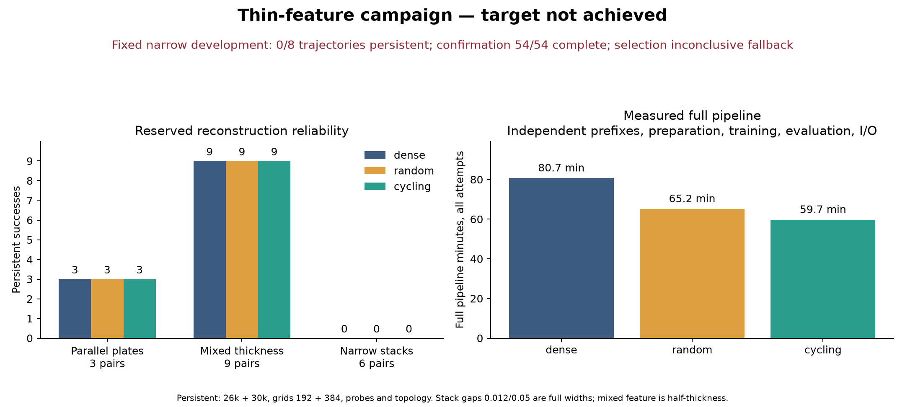

# Thin-feature campaign

**Measured saving with unresolved narrow reliability:** cycling reduces full fixed-trajectory pipeline time by 26.00%, preserves all dense successes, and passes aggregate error guards. Every arm has 12/18 persistent successes and 0/6 narrow-stack successes. On the 12 jointly successful pairs, first observed persistent correctness is 157.77s vs dense 177.87s (11.30% reduction). These are separate retrospective measurements; the complete reliability target is not achieved.

**Target not achieved.** Completed 54/54 independent confirmation trajectories. 
Selected configuration: SIREN, width 128, depth 3; development selection inconclusive (frozen SIREN fallback).

| Arm | Persistent successes /18 | Full pipeline seconds, all attempts | Seconds per persistent success |
|---|---:|---:|---:|
| dense | 12 | 4841.2 | 403.4 |
| random | 12 | 3909.8 | 325.8 |
| cycling | 12 | 3582.3 | 298.5 |

| Family | Dense successes | Random successes | Cycling successes |
|---|---:|---:|---:|
| parallel plates | 3/3 | 3/3 | 3/3 |
| mixed thickness | 9/9 | 9/9 | 9/9 |
| multiscale plate stack | 0/6 | 0/6 | 0/6 |

Cycling/dense actual pipeline ratio: 0.7400. Lost dense successes: 0. Narrow-stack six-pair gate with error guards: fail.

Missing, failed, unresolved and nonfinite evaluations fail closed. Failed attempts remain in pipeline totals. Unstarted trajectories are explicitly censored in trajectories.csv and prevent a complete-evidence claim.

Persistent success requires both 26k and 30k, both grids 192 and 384, every original probe sign, closed mesh edges, expected components/Euler and resolved analytic references. Onset at23k requires all three checkpoints; onset26k requires26k+30k. These are retrospective checkpoint-limited observations, not online stopping.

Runtime includes independently repeated prefixes, pool/label generation, random schedules, evaluation, transfers and checkpoint/hash I/O. Worker cumulative onset time includes supervisor launch and interpreter startup; final closure overhead appears in full pipeline totals. Historical attributed savings are separate and do not establish this target. Historical error guards compare endpoint means across the full paired set; per-pair guards are separately reported, with strict narrow-stack preservation.

Scope: oracle analytic box unions in three families. Known regions and exact SDF labels are used. This is not arbitrary unseen-shape evidence or a topology guarantee. Fourier features test bandwidth; they do not promise topology repair.

Random is evaluated identically. If random matches cycling, these results do not establish balancing necessity or superiority.

See protocol.json, audit.json, budget.json, paired-results.csv and trajectories.csv for immutable setup, failures and measurements.

## Measured comparison and limitations

Cycling saves 26.00% of the full fixed-trajectory pipeline. On 12 jointly successful pairs, mean first observed persistent correctness is 157.77 s vs dense 177.87 s (11.30% reduction). Random conditional correctness is 174.73 s (1.76% reduction). These conditional retrospective timings do not establish online stopping or resolve the failed narrow-stack pairs.

Full pipeline is external supervisor launch through durable process exit, including interpreter startup, independently repeated initialization/prefixes, labels/pools, random schedules, recovery, transfers, evaluations, checkpoints and hashes. Failed attempts count. These are new actual wall clocks, distinct from earlier shared-prefix attribution.

| Arm | Actual pipeline minutes | Saving against dense | Persistent successes |
|---|---:|---:|---:|
| dense | 80.686 | 0.00% | 12/18 |
| random | 65.164 | 19.24% | 12/18 |
| cycling | 59.706 | 26.00% | 12/18 |

Family denominators per arm: parallel plates 3, mixed thickness 9, multiscale stacks 6. Mixed feature values 0.015/0.03/0.06 are half-thickness (full thin thickness 0.03/0.06/0.12); stack gaps 0.012/0.05 are full widths.

Repair charged 59.952/60 minutes: 13/16 screen trajectories completed, 1 retained file-access failure and 2 unstarted. All 8 narrow development trajectories failed persistent gates. Model comparison is inconclusive; the frozen SIREN fallback was used, without validation-seed expansion. This does not prove either architecture incapable of narrow reconstruction.

Target checks: complete evidence=pass; lost dense successes=0; cycling aggregate error guards=pass; all 6 narrow stack pairs persistent with individual guards=fail. Speed saving and dense-success preservation do not establish narrow reliability.

| Arm | Endpoint | Gap RMSE ratio (limit 1.10) | Full-gap sign delta (minimum−0.005) | Chamfer192 ratio (limit 1.05) | Chamfer384 ratio (limit 1.05) | Pass |
|---|---:|---:|---:|---:|---:|---|
| random | 26000 | 1.06356 | -0.00028 | 0.99999 | 1.00232 | pass |
| random | 30000 | 1.05016 | -0.00024 | 0.99913 | 1.00020 | pass |
| cycling | 26000 | 1.06568 | -0.00063 | 1.00100 | 1.00224 | pass |
| cycling | 30000 | 1.05979 | -0.00008 | 0.99937 | 1.00175 | pass |

Conditional checkpoint-limited observed time to correctness applies only to jointly persistent successful pairs. It excludes paired failures from this conditional statistic; their consumed time and null onset remain in trajectories.csv and full pipeline totals. It is retrospective, not an online stopping policy.

| Candidate | Jointly successful pairs | Candidate mean seconds | Dense mean seconds | Reduction |
|---|---:|---:|---:|---:|
| random | 12 | 174.73 | 177.87 | 1.76% |
| cycling | 12 | 157.77 | 177.87 | 11.30% |

Representative narrow failure, case 6 seed 71 dense 23k: analytic references resolved three components/Euler 6 at both 192/384; predicted closed meshes have two components, Euler−56/−8 respectively. Original component interior signs passed at that checkpoint. This identifies a topology mismatch without identifying which boxes merged. All reference-resolution totals and every checkpoint failure reason are exported.

[Execution, dimension conventions and artifact audit](supplement.md). The sealed reporter remains unchanged; this editorial section is generated by the separately hashed read-only analysis script.

The [NeurIPS 2020 Fourier-features paper](https://proceedings.nips.cc/paper_files/paper/2020/hash/55053683268957697aa39fba6f231c68-Abstract.html) motivates testing high-frequency regression through tunable bandwidth. It does not establish topology repair. The present fixed Fourier configuration failed measured narrow development gates; incomplete screening prevents a general architectural conclusion.
